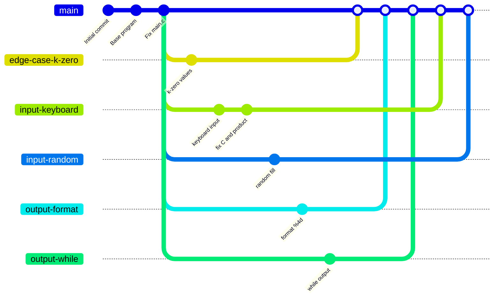

# 🧮 array-lab6


> **Основи роботи з Git. Робота з гілками: командна розробка.**
> Навчальний проєкт: масиви в C та командна робота в GitHub.

---

## 📌 Опис задачі (варіант 3)

Дано цілочисловий масив **A**. Створити масив **C** з остач від ділення елементів **A** на ціле число **k** (k < 10), яке вводиться з клавіатури. Обчислити добуток ненульових елементів масиву **C**. Вивести на друк заданий і новоутворений масиви.

### ⚠️ Особливі випадки

| Ситуація | Поведінка програми |
|----------|--------------------|
| `k = 0` | повідомлення про помилку (ділення на нуль) |
| `k >= 10` | повідомлення про помилку |
| усі остачі нульові | повідомлення, що добуток не існує |

---

## 🚀 Збірка і запуск

```
gcc main.c -o main
./main
```

## 💡 Приклад

<details>
<summary>Показати приклад ввід/вивід</summary>

Ввід:
```
Enter array size (1-100): 5
Fill array: 1 - from keyboard, 2 - random: 1
Enter 5 integers: 3 7 10 12 8
Enter integer k (k < 10): 3
```

Вивід:
```
Array A:    3   7  10  12   8
Array C:    0   1   1   0   2
Product of nonzero elements of C: 2
```
</details>

---

## 🌿 Гілки проєкту

| Гілка | Призначення |
|-------|-------------|
| `main` | 🟢 фінальна версія програми |
| `edge-case-k-zero` | 🔴 особливий випадок: усі остачі нульові |
| `input-keyboard` | ⌨️ ввід розміру й елементів з клавіатури |
| `input-random` | 🎲 заповнення масиву генератором випадкових чисел |
| `output-format` | 🎨 форматований вивід (`%4d`) |
| `output-while` | 🔁 вивід через цикл `while` |

### 🗺️ Схема гілок



Усі гілки злито в `main`, конфлікти при злитті вирішено вручну.

---

## 👥 Команда

| Учасник | Завдання |
|---------|----------|
| Саленко Владислав (координатор) | варіант 3, основна програма, гілки, злиття |
| Роїв Артем     |гілка `readme-docs`, опис проєкту в README |
| Сидор Роман    |гілка `code-comments`, коментарі до коду|
| Петро Руданець |гілка `test-cases`, файл з тестами |

---

## 🛠️ Корисні команди Git

<details>
<summary>Показати команди</summary>

```
git branch -a                      # список гілок
git log --oneline --graph --all    # історія змін
git merge <гілка>                  # злиття гілки з поточною
git push -u origin <гілка>         # відправлення гілки на GitHub
```
</details>